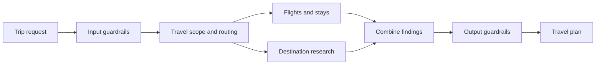

# Travel Planner AI Assistant

I started this project in a Jupyter notebook to explore how specialist AI agents could work together on a travel request. It has since grown into a web app: a place to describe a trip, explore flight and hotel options, and get an itinerary shaped around your interests.

I’m building it in public and looking for feedback on both the planning experience and the usefulness of the results.

**[Try the travel planner](https://travel-planner-ai-assistant.vercel.app)** · [Original notebook](Multi_Agent_Travel_Planner.ipynb)

## Take it for a spin

You can open the example plan without an invitation. For live planning, ask me for an invitation code, then open **Settings → Invitation code** in the sidebar. The code is used for planning requests and is kept out of saved preferences and plan downloads.

Start with a destination. Add a departure city, dates, travelers, and a budget if you have them. Pick the interests that matter to you, then tell the planner what would make the trip special.

For example:

> Five days in Kyoto for two adults. We like local food, small neighborhoods, and a relaxed pace. Include places to stay and leave time to explore on our own.

Your name, interests, draft, and last five completed plans stay in your browser. You can reopen a plan or download it as JSON. There is no account sync yet, so clearing browser storage removes those saved plans. Please keep contact details, personal IDs, and payment information out of trip requests.

## What I’m building

The experience is meant to feel like a personal travel workspace:

- A guided trip builder, with room for preferences that do not fit a form field.
- Flight and hotel research when enough details are available.
- Destination research and an itinerary matched to the trip.
- Progress updates while research runs, with technical execution details kept off the page.
- A Microsoft-inspired blue theme, sidebar settings, and a mobile layout.

The app researches options. It does not book trips, take payments, or confirm reservations. Prices and availability need to be checked with the provider before booking.

## How the agents work together

A LangGraph workflow routes each request to a flight/hotel specialist, a destination-research specialist, or both. Their findings feed a final synthesis step.



OpenAI powers the models. SerpAPI supplies Google Flights and Google Hotels searches; Tavily supplies web research. FastAPI serves the app, and Vercel hosts it.

The research loop has an explicit tool allowlist. The web runtime does not expose a shell, filesystem, arbitrary URL fetcher, booking tool, or payment tool to the agents. The original notebook is still in the repository, but web requests run the Python modules in `planner/`.

## The boundaries I’ve put around the beta

Sharing an AI app also means managing misuse and API spending. These controls are implemented in the app:

- **Invitation-only planning:** the server checks the access key before reading a planning request or starting paid work. Production requires a key of at least 32 characters.
- **Input and output moderation:** OpenAI’s `omni-moderation-latest` checks the request and final answer. A failed or unavailable check stops delivery.
- **Local pattern checks:** Unicode-normalized regex rules catch common instruction overrides, prompt extraction, credentials, and several personal-data formats. Configured secrets and patterned PII are removed from final answers.
- **Travel-only scope:** the existing routing model also checks whether the request belongs in this app. There is no model-based NER or separate generative guardrail-model call.
- **Untrusted sources:** agents receive a security policy, and recognizable instruction injections are removed from retrieved text before it is used as research data.
- **Bounded research:** a request has at most 16 model invocations, eight search calls, three tool calls per batch, 2,000 output tokens per planner-model call, 50,000 characters of model context, and 180 seconds overall. Planner-model and moderation retries are disabled.
- **Browser protections:** request-size checks, cross-site submission checks, a restrictive Content Security Policy, and text-based Markdown rendering reduce the browser attack surface.

No Redis or extra database account is required. Each worker also keeps best-effort limits of three plans per UTC minute, 30 per UTC day, and two concurrent plans. **These counters reset when a worker restarts and are independent across Vercel instances. They are not an app-wide spending cap.**

When a trip exceeds its research allowance, the app explains how to simplify it and whether it can be retried now or after the current worker’s quota resets. Waiting alone will not make an overly broad request smaller.

These layers reduce risk; they do not solve prompt injection or recognize every form of personal data. The shared invitation code can also be redistributed. I’m keeping this as a limited beta while I learn from real use. Individual sign-in and durable per-user quotas would be needed for broader access.

## Running my setup locally

Use Python 3.12 and start from the repository root:

```bash
git clone https://github.com/satykrishna/travel-planner-ai-assistant.git
cd travel-planner-ai-assistant
python3 -m venv .venv
source .venv/bin/activate
python -m pip install -r requirements.txt
cp .env.example .env
```

Fill in the three provider keys in your local `.env`:

- `OPENAI_API_KEY` — [OpenAI API keys](https://platform.openai.com/api-keys).
- `TAVILY_API_KEY` — [Tavily dashboard](https://app.tavily.com).
- `SERPAPI_API_KEY` — [SerpAPI key](https://serpapi.com/manage-api-key).

Generate your own invitation code with `openssl rand -hex 32` and put it in `.env` as `APP_ACCESS_TOKEN`. It is optional locally and required on Vercel. Keep `.env` out of Git; the repository includes only empty placeholders.

```bash
uvicorn app:app --reload
```

Open **http://127.0.0.1:8000**. Provider calls can consume credits or incur charges. Set `PLANNING_ENABLED=false` and restart to pause live planning.

For the original experiment, run `jupyter lab Multi_Agent_Travel_Planner.ipynb`. Its live-example flags are disabled by default so opening and running definitions does not intentionally launch a trip search.

## What I look at in LangSmith

The public page shows the trip, not tool calls or agent traces. I use LangSmith privately to inspect the workflow, model calls, tool operations, guardrail steps, timing, and token usage.

To enable it, add these server-side variables locally and in Vercel:

```dotenv
LANGSMITH_API_KEY=your_langsmith_key
LANGSMITH_TRACING=true
LANGSMITH_PROJECT=travel-planner
LANGSMITH_ENDPOINT=https://api.smith.langchain.com
```

For an EU account, use `https://eu.api.smith.langchain.com`. Add `LANGSMITH_WORKSPACE_ID` if your key requires it. Restart or redeploy after changing the configuration.

The root trace is called `travel_plan_request`. **Inputs and outputs are visible after local credential and PII redaction**, including the trip request and final answer. Nested spans show the model and tool data needed to debug a result. Redaction uses patterns and configured secret values; it cannot guarantee that every private detail is recognized, so trace-project access should stay restricted.

Trace events, attachments, serialized manifests, runtime details, and unexpected metadata are excluded. Token-usage metadata is retained. The app makes a bounded attempt to flush traces before a serverless request ends; a LangSmith outage does not disable planning. Requests rejected by authentication, body validation, or worker rate limits happen before the workflow trace starts.

LangSmith is optional and has its own usage allowance. The app does not enable a paid LangSmith plan.

## Deploying to Vercel

Connect this repository to a Vercel project. `app.py` is the FastAPI entrypoint; `vercel.json` contains the deployment configuration.

Set the three provider keys and `APP_ACCESS_TOKEN` in Vercel’s environment settings. Add the optional LangSmith variables if tracing is wanted. Pushes to the linked `main` branch trigger deployments; environment changes also need a redeploy. To pause live planning, set `PLANNING_ENABLED=false` and redeploy.

The invitation code belongs in the app’s sidebar Settings. Provider keys and the LangSmith key belong only in server-side environment settings.

## Checking changes

The safety suite uses mocked providers and tracing clients. It covers injection patterns, PII handling, moderation, access checks, research budgets, worker limits, trace redaction, and failure paths without making paid API calls.

```bash
python -m pip install pytest
python -m pytest tests -q
node --check public/app.js
```

Passing those checks verifies the tested enforcement paths. It is not a live adversarial evaluation of the models or a guarantee of safe output.

## What I’d love feedback on

Does the trip builder make it easy to express what you want? Are the recommendations useful enough to act on? Are the limits and error messages understandable? Tell me where the experience feels confusing, slow, or incomplete through [GitHub issues](https://github.com/satykrishna/travel-planner-ai-assistant/issues).
