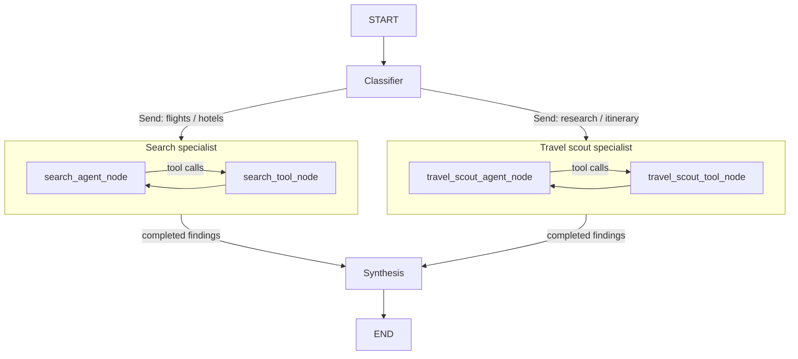

# LangGraph Travel Planner Notebook

A notebook-first, multi-agent travel planner built with LangGraph, LangChain, OpenAI, Tavily, and SerpAPI. It classifies travel requests, dispatches flight/hotel and destination-research specialists, executes structured tool calls in normal Python graph nodes, and synthesizes their findings.

The source is [Multi_Agent_Travel_Planner.ipynb](Multi_Agent_Travel_Planner.ipynb). This repository contains the notebook and its setup files, not the separate travel-agent application.

## What it does

- Searches Google Flights through SerpAPI, applies maximum-stop constraints, and reports the number of returned flight options.
- Searches Google Hotels or vacation rentals, validates stay dates and guest counts, and sorts returned properties by price by default.
- Delegates detailed itineraries to a deep research agent with web search.
- Uses `Send` to dispatch one or both specialist subgraphs in parallel.
- Keeps separate HumanMessage, AIMessage, and ToolMessage histories for each specialist, including tool-call IDs.
- Checks destination-local flight arrival dates against quoted hotel dates before synthesis.
- Prints a readable final answer and a trace of routing decisions and tool calls.

## Workflow



The classifier chooses `search_agent`, `travel_scout_agent`, or both. The specialist subgraphs finish their complete model/tool loops before the parent merges results and runs synthesis once. A request selecting only one specialist does not wait for an unselected branch.

Tools are advertised with `llm.bind_tools(...)`; this only supplies their schemas. The executor nodes resolve tool-name strings through allowlisted dictionaries, call `.invoke(tool_call['args'])`, and create matching `ToolMessage` objects. These executor nodes are ordinary graph functions, not `ToolNode` instances.

## Requirements

- Python 3.11 or 3.12; the original notebook was developed in PyCharm with Python 3.12.
- An OpenAI API key, a Tavily API key, and a SerpAPI key with access to Google Flights / Google Hotels searches.
- JupyterLab or PyCharm with notebook support.

The main agent dependencies in `requirements.txt` are pinned to versions observed in the source notebook's working environment. Model calls and search calls may incur charges or consume provider quotas.

## Setup

```bash
git clone https://github.com/satykrishna/langgraph-travel-planner-notebook.git
cd langgraph-travel-planner-notebook
python3 -m venv .venv
source .venv/bin/activate
python -m pip install -r requirements.txt
cp .env.example .env
```

On Windows, activate with `.venv\Scripts\activate` instead. Add your own values to `.env`:

```dotenv
OPENAI_API_KEY=your_openai_key
TAVILY_API_KEY=your_tavily_key
SERPAPI_API_KEY=your_serpapi_key
```

Run the kernel from this repository's root so the `.env` cell can locate the file. Existing process environment variables take precedence. Restart the kernel after changing previously loaded values. Never commit `.env`, credentials, or sensitive notebook output.

```bash
jupyter lab Multi_Agent_Travel_Planner.ipynb
```

In PyCharm, open the repository, select its Python interpreter, and open the notebook.

## Running the notebook

1. Install dependencies and load `.env`.
2. Run the definition cells in order: model and tools, prompts, Pydantic schemas, shared state, classifier, specialist nodes, synthesizer, and combined graph.
3. Keep the default flags disabled while exploring definitions:
   ```python
   RUN_LIVE_EXAMPLES = False
   RUN_INTERACTIVE_CHAT = False
   RUN_REFRESH_SYNTHESIS = False
   ```
4. Enable only the live examples you intend to execute. Interactive chat loops are separately guarded so they cannot block a normal run of the definition cells.

Sections 1–16 demonstrate the individual tools and earlier standalone agents. Sections 17–24 define the shared-state workflow. The combined graph is `travel_planner_workflow`; the old search-only graph is not required.

To run the final workflow directly after its definitions:

```python
query = (
    "Plan a trip for two adults from YYZ to CDG, departing December 10, 2026 "
    "and returning December 13, 2026. Find flights with at most one stop, "
    "one hotel room for December 11–13, and a relaxed sightseeing itinerary. "
    "Respect actual arrival dates and do not book anything."
)

travel_planner_result = travel_planner_workflow.invoke(
    {
        "user_query": query,
        "messages": [],
        "agent_results": [],
        "search_agent_messages": [],
        "travel_scout_agent_msgs": [],
    },
    config={"recursion_limit": 80},
)

print(travel_planner_result["synthesized_answer"])
display_travel_planner_result(travel_planner_result)
```

Update the example dates when they are no longer in the future. Start every new workflow run with fresh specialist histories and results. This example performs live requests; it is not an offline test.

To inspect nested progress instead of waiting for `.invoke()`:

```python
for namespace, update in travel_planner_workflow.stream(
    {
        "user_query": query,
        "messages": [],
        "agent_results": [],
        "search_agent_messages": [],
        "travel_scout_agent_msgs": [],
    },
    config={"recursion_limit": 80},
    stream_mode="updates",
    subgraphs=True,
):
    print(namespace, update)
```

Trace output may contain travel requests and provider results. Review it before sharing or committing.

## Date consistency and search limitations

- Overnight flights can arrive the day after departure. The date checker compares each returned option's destination-local arrival with the hotel dates actually searched.
- Explicit hotel dates are preserved. A hotel stay starting before arrival is flagged as a possible extra night, rather than silently changed.
- Different hotel dates require a new search; quotes must not be relabeled or prorated for a shorter stay.
- The synthesizer is instructed to keep activities within the arrival/return window. Its prose is still model-generated and should be reviewed; the deterministic checks do not validate every itinerary sentence.
- The hotel API does not expose a documented room-count filter. This notebook records `no_of_rooms` and rejects multi-room requests rather than claiming verified multi-room availability.
- `airbnb_type=True` means Google Vacation Rentals, not Airbnb-only listings. Children require one age entry each.
- Hotel counts and sorting cover the returned page. Flight counts represent returned itinerary options, not every available flight.
- Search-result flight legs do not necessarily include a selected return itinerary. The workflow does not book or confirm reservations.
- Unknown tool names are skipped by the simple manual executors, and invocation errors propagate. This is a learning notebook, not a hardened public API.
- `KeyboardInterrupt` means execution was stopped. Deep research may take longer than direct search calls; use progress output or streaming to inspect it.

## Repository files

- `Multi_Agent_Travel_Planner.ipynb`: clean notebook copy with no saved outputs or execution counts.
- `requirements.txt`: notebook dependencies.
- `.env.example`: empty credential placeholders.
- `.gitignore`: excludes local secrets, environments, checkpoints, and IDE files.
- `validate_notebook.py`: checks notebook structure, Python-cell syntax, required workflow definitions, and absence of saved outputs without executing cells.

To validate the clean notebook without making API requests:

```bash
python validate_notebook.py
```

The notebook was copied through PyCharm's notebook model; the original working notebook and its outputs are not modified. No API keys are included.

## Deployment status

This repository is the notebook project. It is not yet a Vercel deployment. Vercel hosting requires extracting the runtime workflow into importable Python, providing an HTTP endpoint and UI, and configuring server-side environment variables and execution limits. Notebook display, package-install, and `input()` cells are development conveniences and should not run in a serverless request.
